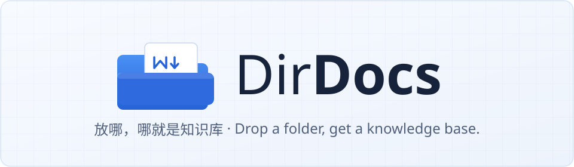
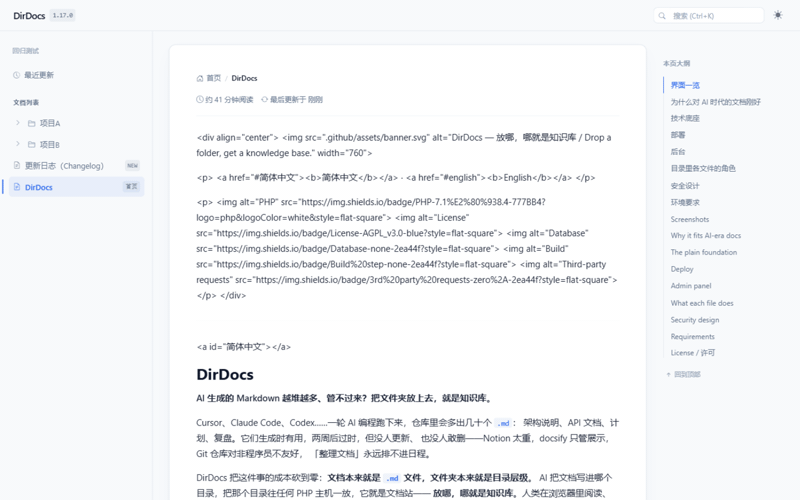
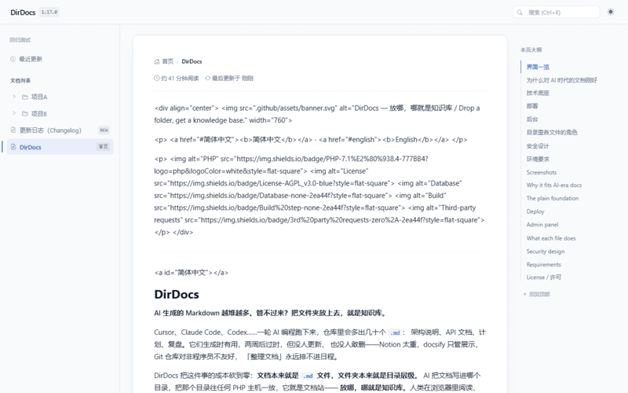
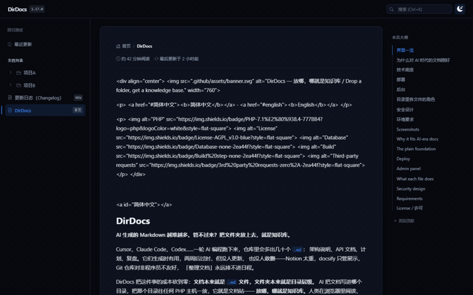
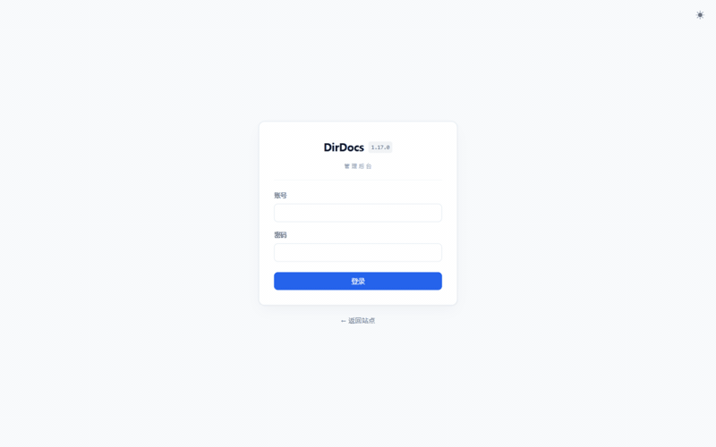

<div align="center">
  

  <p>
    <a href="#简体中文"><b>简体中文</b></a> ·
    <a href="#english"><b>English</b></a>
  </p>

  <p>
    
    
    
    
    
  </p>
</div>

---

<a id="简体中文"></a>

# DirDocs

**AI 生成的 Markdown 越堆越多、管不过来？把文件夹放上去，就是知识库。**

Cursor、Claude Code、Codex……一轮 AI 编程跑下来，仓库里会多出几十个 `.md`：
架构说明、API 文档、计划、复盘。它们生成时有用，两周后过时，但没人更新、
也没人敢删——Notion 太重，docsify 只管展示，Git 仓库对非程序员不友好，
「整理文档」永远排不进日程。

DirDocs 把这件事的成本砍到零：**文档本来就是 `.md` 文件，文件夹本来就是目录层级**。
AI 把文档写进哪个目录，把那个目录往任何 PHP 主机一放，它就是文档站——
**放哪，哪就是知识库**。人类在浏览器里阅读、搜索、投票、留评；AI 工具继续按
老习惯读写同一批纯文件。没有新平台要喂，没有内容要迁移——
写进目录的那一刻，它已经在知识库里了。

## 界面一览

| 前台 · 阅读 | 主题切换（浅色 ⇄ 深色） |
|---|---|
|  |  |
| **全站搜索**（Ctrl+K） | **后台 · 管理** |
|  |  |

<sub>▶ 高清视频：[主题切换](.github/assets/theme-toggle.mp4) · [全站搜索](.github/assets/search.mp4) · [最近更新](.github/assets/recent.mp4)</sub>

## 为什么对 AI 时代的文档刚好

- **零改造接入**：AI 常写的 front matter 直接生效——`title` 定标题、`order` 定顺序、
  `draft: true` 藏草稿；`01-`、`02-` 数字前缀排序也认识
- **AI 反复重写有后悔药**：在线编辑每次覆盖保存自动留修订版本（每篇最近 20 版），
  可预览、对比、一键恢复；没定稿的先标 `draft: true`，导航/搜索/订阅/sitemap
  全部隐身，后台仍可预览
- **过时的文档自己浮上来**：每篇底部「这篇文档有帮助吗」匿名投票，聚合计数汇入后台，
  「需改进」多的排前排——就是下一批让 AI 重写的清单（IP 只以哈希进当日限流记账，
  不存原文；只读部署自动隐藏投票胶囊）
- **读者能留话，垃圾进不来**：每篇底部评论表单，先审后显（后台「评论」页批准/删除）；
  数据以 `<文档名>.cmt.php` 形式存放在文档旁（首行 PHP 执行锁，直访 403，
  不依赖服务器配置），随文档改名/删除自动跟移；写路径 flock 持锁事务 + 原子替换，
  双提交令牌 + 当日限流（10 条/天）+ 时间陷阱 + 蜜罐；可选 SMTP 邮件通知
  （新评论提醒站长、回复提醒被回复者；SMTP 主机不填则零外联，发信失败静默）
- **机器同样可读**：`?a=rss` 订阅最近 20 篇更新，`?a=sitemap` 全站清单；
  文档本体永远是目录里的纯文件，编辑器、脚本、AI 工具随时直接读写
- **找得到**：前台 `Ctrl+K` 呼出全站搜索弹窗；最近更新页支持按月浏览
  （`?a=recent&ym=2026-10`，只在有更新的月份之间切换）

## 技术底座

上面这些能力不依赖任何云服务，靠的是一套刻意朴素的底座：

- 零安装：无安装向导、无路径配置、无数据库、无 composer 依赖
- 零构建：原生 PHP + CSS 变量换肤，前端无框架
- 零外联：Bootstrap / 图标字体 / mermaid / 二维码库全部自托管在 `_dir/assets/vendor/`，
  运行时不向任何第三方域发出请求；两处例外都须站长在后台显式开启——SMTP 发信
  （不填主机则全程不发信）与新版本检查（默认关闭，开启后每天至多查一次 GitHub Releases）。
  内网/断网环境保持默认即可
- 兼容 PHP 7.1 ~ 8.4（廉价虚拟主机大量停在 7.x）
- 中英双语界面：`language` 配置可选 auto（按浏览器语言自动）/ zh-CN / en，只翻界面不翻内容
- 全站打印样式
- 安全基线：唯一执行面是 `index.php`；用户内容一律白名单 + 转义后才输出
  （逐条机制见下文「安全设计」）

## 部署

把 `index.php` 与 `_dir/` 拷进目标目录，访问一下即用
（[Releases](https://github.com/mywl6/DirDocs/releases/latest) 的 zip 解压即是这两样）：

```
你的目录/
├── index.php        ← 入口：boot + 路由分发，部署后极少改动
├── _dir/            ← 程序本体，随包分发（升级覆盖 lib/ 与 assets/）
│                       config.php、cache/ 等运行时数据首次访问自动生成
├── 项目A/
│   ├── 说明.md
│   └── 架构图.png
└── 项目B/...
```

放在 Web 根目录 = 整个根都是文档；放在 `/docs/` 子目录 = 那一层就是文档站。

**升级**：用新版本的 `_dir/lib/` 与 `_dir/assets/` 覆盖旧的两个目录即可
（程序版本号在 `_dir/lib/version.php`，随 lib 一起更新，`index.php` 通常不用动——
它只在路由调整时随版更新）。你的数据（`_dir/config.php`、`_dir/cache/`）不会被覆盖。

`_dir/themes/` 里只有**你自己建的主题**，升级时一个都不用动。内置的 default / wiki
不需要你操心：它们的权威副本随 `_dir/lib/` 一起升级（放在 `_dir/lib/builtin-themes/`），
程序会在打开后台时把副本同步到 `_dir/themes/default/`、`_dir/themes/wiki/`——
想在新版里改内置主题的样式，请整套复制到 `_dir/themes/<你自己的名字>/` 再改，
那两个名字底下的文件（不管在哪一边）都会被覆盖回去。
`ocean` 是随包示例主题，属于普通自建主题，可改可删。
各版本变更见 [CHANGELOG.md](CHANGELOG.md)。

**瘦身**：不需要 mermaid 图表就删掉 `_dir/assets/vendor/mermaid.min.js`（约 3.2MB）——
运行时会自动探测，图表块以源码形态显示，其余功能零影响；后台概览会提示缺失。
需要图表时把文件放回原位（来源与校验和见 `vendor/README.md`）即可恢复。

## 后台

浏览器打开 **`http://你的域名/index.php?a=admin`**（或点任一页面右下角的"后台"链接）。

首次进入先设定管理员密码（至少 8 位），之后用密码登录。后台做六件事：

1. **站点设置**——标题、副标题、界面语言、路由模式、白名单后缀、改密码
2. **主题**——风格包与显示模式，以及当前主题声明的**主题选项**（见下）
3. **文档管理**——在线编辑/新建 Markdown（大编辑请用本地编辑器，网页编辑用于救急）；
   覆盖保存自动留修订版本（每篇最近 20 版），后台可预览、对比、一键恢复
4. **附件上传**——上传到指定目录，白名单后缀（图片/pdf/zip/mp4…）
5. **缓存管理**——重建/清除索引，查看最近更新
6. **评论管理**——访客评论先审后显：待审清单、批准、删除

设置页还有一张**新版本检查**卡（默认关闭）：开启后后台每天至多查一次 GitHub Releases，
有新版时概览的「程序版本」行旁出现一枚可点徽标。检查结果缓存在 `_dir/cache/update.json`，
网络不可达时安静标为「检查失败」，不影响任何功能。

登录失败 5 次锁定 10 分钟。

### 主题与主题选项

主题是**风格包**，放在 `_dir/themes/<名称>/`：一个 `theme.php` 给出名称与深浅两套色板即可
（纯配色包，共用默认版式）；再加一个 `view.php` 就是完全不同的整页版式。
显示模式（自动 / 浅色 / 深色）与主题独立，访问者右上角按钮还能临时切换。
后台「主题」页可切换主题与模式，并列出每个包的版式形态与声明了几项选项。

内置的 `default` / `wiki` 由程序自己维护（权威副本在 `_dir/lib/builtin-themes/`，
打开后台时同步到 `_dir/themes/`）。**要定制就整套复制成 `_dir/themes/<你自己的名字>/`
再改**——改 default / wiki 这两个名字底下的文件会被下一次同步覆盖回去。

**主题选项**让「主题作者声明 → 站长在后台填写 → 前台读取」这条链路成立。主题在 `theme.php`
里声明 `options`，后台主题页就自动出现对应控件，支持六种类型：

| 类型 | 控件 | 内置示例 |
|---|---|---|
| `select` | 下拉 | 圆角风格（跟随主题 / 直角 / 小圆角 / 大圆角） |
| `color` | 取色器 + 文本框 | 主题主色 |
| `toggle` | 开关 | 扁平化（去掉卡片阴影） |
| `number` | 数字框（可带单位） | 正文栏宽（px） |
| `text` | 单行文本框 | 页脚补充信息（备案号等） |
| `textarea` | 多行文本框 | 站点公告 |

取值有两种用法，可同时用：

- **自动写 CSS 变量**——声明 `css`（变量名列表）、`css_rgb`（该色的 RGB 三元组，喂 Bootstrap 的
  `--bs-*-rgb`）、`css_tpl`（如 `--accent-weak => rgba({rgb},.12)`），选项值会并入页面内联变量块；
  深浅两套可各自指定（`css_dark`）。不写一行模板代码就能换色、换圆角、换栏宽、去阴影。
- **模板读取**——`view.php` 里用 `$themeOptions['键']` 或 `md_theme_option($theme, '键')` 取用；
  默认主题就是这么渲染「站点公告」与页脚补充信息的。

选项值**按主题分别保存**在 `_dir/config.php`（换主题不丢，换回来即恢复）；留空 = 跟随主题自带
配色、不写任何覆盖，写坏的值（非色值、超范围数值等）会被拒绝且整份不保存。单击「恢复主题
默认」可清掉当前主题的全部取值。内置的 `default` / `wiki` 各带六个示例选项（六种类型齐备），
写自己的主题时直接照抄改即可。

## 目录里各文件的角色

| 路径 | 角色 | 升级时 |
|---|---|---|
| `index.php` | 入口：boot + 加载 + 路由分发（版本号读取也在这） | 极少变，随包覆盖即可 |
| `_dir/lib/` | 业务代码（engine/i18n/pages/theme/admin 五模块）、版本号 `version.php`、`lang/` 语言包、内置主题权威副本 `builtin-themes/` | 覆盖 |
| `_dir/assets/` | 内置 CSS/脚本 + 自托管三方库（`vendor/`：Bootstrap/图标/mermaid/qrcode） | 覆盖 |
| `_dir/config.php` | 你的站点配置 | 不动 |
| `_dir/cache/` | 索引缓存（可随时删） | 不动 |
| `_dir/themes/` | 主题：你自建的主题 + `ocean`（示例） + 内置 default/wiki 的运行期镜像 | 自建的不动；镜像由程序自动同步 |
| 其余目录 | 你的文档与附件 | 不动 |

## 安全设计

机制全部列在明面上，可对照源码逐条验证：

- **原子写**：配置与缓存的写入一律「临时文件（`LOCK_EX`）+ `rename()` 原子替换」，
  并发写或中途断电都不会留下半截文件，写失败有回滚路径。
- **链接协议白名单**：Markdown 先全文转义再还原 URL，URL 只放行
  `http` / `https` / `mailto`（判断前先剥掉控制字符与零宽字符），
  危险协议丢链接、留文字。
- **符号链接拒绝**：路径经 `realpath()` 归一后按分隔符整段校验前缀
  （`/foo` 不会命中 `/foobar`），`is_link()` 命中即拒——软链出去的内容不可达；
  文件类型另走扩展名白名单。
- **附件一律走程序输出**：两种 URL 模式下附件都不经 Web 服务器静态直出，
  过扩展名白名单与可见性校验后才输出。`svg`/`md`/`txt` 一律
  `Content-Disposition: attachment`，堵掉 SVG 内嵌脚本的主通道；唯一例外是
  `` 嵌入（`Sec-Fetch-Dest: image`）：SVG 以图片模式加载时脚本本就不执行，
  程序放行内联并追加 `script-src 'none'` 双保险，其余一切上下文（直接开链接 /
  iframe / object）仍强制下载。中文文件名按 RFC 5987 输出；pretty 模式的
  重写规则对这四类后缀同样不直出（后台规则生成器已包含）。
- **唯一执行面**：整个站点可执行的只有 `index.php`；`_dir/lib/*.php` 带 `MD_BOOT`
  闸门，被直接 Web 访问时输出 403，一行代码不执行。
- **站内跳转**：后台的跳转目标、canonical、资产 URL 全部由程序内的路径前缀拼出，
  拼装前统一收口为「空 或 单个前导斜杠 + 纯路径」——前缀里即便混进主机名
  （`//host/...`）或 scheme，也只会被浏览器当成本站路径，不产生站外跳转。
- **`_dir` 目录双层防护**：程序自动生成 `_dir/.htaccess`（Apache 整目录拒绝直访；
  资产与附件全部走程序通道，拒绝直访零功能损失），缺失时每次启动自动补种；
  修订版本文件是带闸门的 PHP 数据文件，被直接访问时输出 403 空白——即使服务器
  没有目录级防护（Nginx 共享主机贴不了规则），缓存与草稿历史也不会泄露。
  Nginx 规则可在后台「设置 → 服务器加固」按安装路径直接复制。
- **后台**：密码 `password_hash` 存储；登录失败按 IP+UA 锁定；
  所有 POST 过 CSRF token（`hash_equals` 时序安全比较）；
  会话 Cookie `HttpOnly + SameSite=Lax`；
  可选 TOTP 两步验证（RFC 6238 纯 PHP 实现，设置页扫码/手输密钥绑定，
  动态码失败与密码共用锁定节奏，会话内防重放；验证器丢失时删除
  `_dir/config.php` 的 `admin_totp` 一行即可复位）。
- **CSP**：每页下发 `Content-Security-Policy`（`default-src 'self'`、
  `script-src 'self'`、`form-action 'self'`、`base-uri 'self'`）。
  全资源自托管后策略是纯本站，不放行任何第三方域；
  `style-src` 保留 `unsafe-inline` 仅为程序生成的主题变量块。
  页面上出现的站外地址（页脚/后台的项目主页）都是**普通链接与标识**，不是页面的资源引用，
  不由浏览器自动加载，CSP 与零外联策略都不受影响。
- **HTTP 层**：ETag/304 条件请求、单区间 Range（206/416 边界处理）、
  界面语言为自动模式时下发 `Vary: Accept-Language`（共享缓存按语言区分）、
  `display_errors` 强制关闭不泄露路径。
- **结构性风险告知**：文档目录里混入 `.php`/`.html` 等文件时，
  程序不会输出它们（白名单外不可见、不可下载）；但 Web 服务器仍可能按自己的规则
  直接响应它们——程序会扫描这类风险文件并在页面顶部警示（管理员登录后可见清单）。
  请只存放文档与附件。

## 环境要求

- PHP 7.1 ~ 8.4，需要 `mbstring`（缺失时搜索降级）、`session`
- Apache / Nginx / php -S 均可；**无需任何重写规则**（查询串路由零配置）
- 想要 `/项目A/说明` 这样的干净 URL：后台设置里切到 pretty 模式，
  页面会给出对应你安装路径的 rewrite 规则，粘贴到服务器配置即可

---

<a id="english"></a>

# DirDocs

**Drowning in AI-generated Markdown? Drop a folder onto a PHP host — that's your knowledge base.**

Cursor, Claude Code, Codex… every round of AI coding leaves dozens of `.md` files
behind: architecture notes, API docs, plans, retros. They are useful the day they are
generated, stale two weeks later — nobody updates them, nobody dares delete them.
Notion is too heavy, docsify only renders, Git repos are hostile to non-programmers,
and "organize the docs" never makes it onto the schedule.

DirDocs cuts the cost of this to zero: **docs are already `.md` files, and folders
are already the hierarchy.** Whatever directory the AI writes into, drop that
directory onto any PHP host and it becomes a documentation site —
**put it anywhere, it's a knowledge base.** Humans read, search, vote and comment in
the browser; AI tools keep reading and writing the same plain files as always.
No new platform to feed, no content to migrate — the moment something is written
into the folder, it is already in the knowledge base.

## Screenshots

| Front site · reading | Theme switching (light ⇄ dark) |
|---|---|
|  |  |
| **Site-wide search** (Ctrl+K) | **Admin panel** |
|  |  |

<sub>▶ HD videos: [theme](.github/assets/theme-toggle.mp4) · [search](.github/assets/search.mp4) · [recent](.github/assets/recent.mp4)</sub>

## Why it fits AI-era docs

- **Zero-adaptation intake**: the front matter AI already writes just works —
  `title` sets the heading, `order` sets the position, `draft: true` hides the page;
  `01-` / `02-` numeric prefixes sort too
- **Undo for AI rewrites**: every overwrite-save in the online editor keeps a revision
  (last 20 per doc) with preview, diff and one-click restore; mark unfinished work
  `draft: true` and it vanishes from nav/search/feed/sitemap while staying previewable
  in the admin
- **Stale docs surface themselves**: an anonymous "was this helpful?" vote sits at the
  bottom of every doc; aggregates flow into the admin, and the most-downvoted docs float
  to the top — that list is exactly what the AI should rewrite next (IPs enter the daily
  rate-limit ledger as hashes only, never stored raw; read-only deployments hide the
  voting pill)
- **Readers can talk, spam can't get in**: a comment form at the bottom of every doc,
  held for approval (approve/delete on the admin "Comments" page); data lives beside the
  doc as `<doc>.cmt.php` (first-line PHP execution lock, direct hits get 403, no server
  config required) and follows renames/deletes; the write path uses flock-held
  transactions + atomic replace, double-submit tokens + daily rate limit (10/day) +
  time trap + honeypot; optional SMTP notifications (new comments to the owner, replies
  to the person replied to; with no SMTP host configured there is zero outbound traffic
  and send failures stay silent)
- **Machine-readable too**: `?a=rss` subscribes to the last 20 updates, `?a=sitemap`
  lists the whole site; docs remain plain files in a folder — editors, scripts and AI
  tools read and write them directly at any time
- **Findable**: `Ctrl+K` summons a site-wide search palette; the recent-updates page is
  browsable by month (`?a=recent&ym=2026-10`, switching only between months that have
  updates)

## The plain foundation

None of the above relies on any cloud service. It stands on a deliberately modest base:

- Zero install: no installer, no path configuration, no database, no composer
- Zero build: native PHP + CSS-variable theming, no frontend framework
- Zero outbound requests: Bootstrap / icon fonts / mermaid / the QR library are all
  self-hosted under `_dir/assets/vendor/`; at runtime nothing is requested from any
  third-party domain. Two exceptions exist, both off until the owner opts in on the
  admin: SMTP sending (nothing is sent while the host field is empty) and the update
  check (off by default; once enabled it queries GitHub Releases at most once a day).
  Intranet/offline installs can leave both untouched
- Compatible with PHP 7.1 ~ 8.4 (cheap shared hosting is largely stuck on 7.x)
- Bilingual UI: the `language` config accepts auto (follows the browser) / zh-CN / en —
  UI chrome only, never your content
- Site-wide print stylesheet
- Security baseline: the only executable surface is `index.php`; user content is always
  whitelisted and escaped before output (mechanism by mechanism under
  ["Security design"](#security-design))

## Deploy

Copy `index.php` and `_dir/` into the target directory and visit it — done
(the zip from [Releases](https://github.com/mywl6/DirDocs/releases/latest) is exactly these two):

```
your-dir/
├── index.php        ← entry: boot + routing, rarely touched after deploy
├── _dir/            ← the program itself, ships with the package (upgrades overwrite
│                       lib/ and assets/); runtime data (config.php, cache/) is
│                       auto-generated on first visit
├── ProjectA/
│   ├── overview.md
│   └── architecture.png
└── ProjectB/...
```

At the web root, the whole root is the docs; under `/docs/`, that level is the site.

**Upgrading**: overwrite the old `_dir/lib/` and `_dir/assets/` with the new versions
(the version number lives in `_dir/lib/version.php` and travels with `lib/`; `index.php`
only changes when routing changes). Your data (`_dir/config.php`, `_dir/cache/`) is never
overwritten.

`_dir/themes/` holds **only themes you created yourself** — upgrading never touches them.
The built-in `default` / `wiki` need no attention from you: their authoritative copies ship
with `_dir/lib/` (under `_dir/lib/builtin-themes/`) and the program syncs them into
`_dir/themes/default/` and `_dir/themes/wiki/` when you open the admin. To customize a
built-in theme, copy the whole directory to `_dir/themes/<your-own-name>/` and edit there —
anything under those two names gets synced back. `ocean` is a sample theme: it behaves like
any user-created theme, so edit or delete it freely.
Per-version changes: [CHANGELOG.md](CHANGELOG.md) (Chinese).

**Slimming**: don't need mermaid diagrams? Delete `_dir/assets/vendor/mermaid.min.js`
(~3.2 MB) — the runtime detects its absence, chart blocks render as source code, and
everything else is unaffected; the admin overview flags the missing file. Put it back
(sources and checksums in `vendor/README.md`) to re-enable charts.

## Admin panel

Open **`http://yourdomain/index.php?a=admin`** in a browser (or the "Admin" link in the
bottom corner of any page).

The first visit sets the admin password (at least 8 characters). The admin does six
things:

1. **Site settings** — title, subtitle, UI language, URL mode, allowed extensions,
   password change
2. **Themes** — style packs and color mode, plus the current theme's declared
   **theme options**
3. **Documents** — edit/create Markdown online (use a local editor for long-form work;
   the web editor is for quick fixes); every overwrite-save keeps a revision (last 20
   per doc) with preview, diff and one-click restore
4. **Uploads** — upload attachments to a chosen directory, whitelist extensions
   (images/pdf/zip/mp4…)
5. **Cache** — rebuild/clear indexes, view recent updates
6. **Comments** — visitor comments are held for approval: pending list, approve, delete

Settings also carries an **Update check** card (off by default): once enabled the admin
queries GitHub Releases at most once a day, and a clickable badge appears next to "App
version" on the overview when a newer release exists. The result is cached in
`_dir/cache/update.json`; an unreachable network merely shows "check failed" and never
affects anything else.

Five failed logins lock the account for 10 minutes.

## What each file does

| Path | Role | On upgrade |
|---|---|---|
| `index.php` | Entry: boot + load + route | rarely changes |
| `_dir/lib/` | Business code (engine/i18n/pages/theme/admin) + `version.php` + `lang/` packs + built-in theme sources `builtin-themes/` | overwrite |
| `_dir/assets/` | Built-in CSS/JS + self-hosted vendor libs (Bootstrap/icons/mermaid/qrcode) | overwrite |
| `_dir/config.php` | Your site config | untouched |
| `_dir/cache/` | Index cache (safe to delete) | untouched |
| `_dir/themes/` | Themes: your own + `ocean` (sample) + runtime mirrors of built-in default/wiki | yours untouched; mirrors sync themselves |
| everything else | Your docs and attachments | untouched |

<a id="security-design"></a>

## Security design

Every mechanism is listed in the open — verify each against the source:

- **Atomic writes**: config and cache writes always go through "temp file (`LOCK_EX`) +
  `rename()` atomic replace" — concurrent writes or power loss never leave half-written
  files, and failed writes have a rollback path.
- **Link protocol whitelist**: Markdown is fully escaped first, then URLs are restored;
  only `http` / `https` / `mailto` pass (control characters and zero-width characters
  are stripped before the check). Dangerous protocols lose the link but keep the text.
- **Symlink rejection**: paths are normalized via `realpath()` and validated per
  path segment (`/foo` does not match `/foobar`); any `is_link()` hit is rejected —
  content symlinked out of the tree is unreachable; file types additionally go through
  an extension whitelist.
- **Attachments always served by the program**: under both URL modes attachments never
  hit the web server's static handler; they pass the extension whitelist and visibility
  checks first. `svg`/`md`/`txt` are always sent with `Content-Disposition: attachment`,
  blocking the main channel for SVG-embedded scripts; the single exception is ``
  embedding (`Sec-Fetch-Dest: image`) — SVG loads as an image cannot execute scripts,
  so the program allows inline delivery and adds a `script-src 'none'` belt-and-suspenders;
  every other context (direct link, iframe, object) still forces a download. Chinese
  filenames follow RFC 5987; pretty-mode rewrite rules never serve these four extensions
  statically either (the admin rule generator includes this).
- **Same-site navigation**: admin redirect targets, canonicals and asset URLs are all
  built from the program's own path prefix, which is normalized to "empty or a single
  leading slash + plain path" before assembly — even if the prefix somehow carries a
  hostname (`//host/...`) or a scheme, browsers resolve it as a local path, so no
  off-site redirect ever comes out of it.
- **One executable surface**: the only executable file in the whole site is `index.php`;
  `_dir/lib/*.php` files carry an `MD_BOOT` gate and answer direct web access with a 403
  without executing a single line.
- **Two-layer `_dir` protection**: the program auto-generates `_dir/.htaccess`
  (Apache denies direct access to the whole directory; assets and attachments all flow
  through the program channel, so denying direct access costs nothing), and re-seeds it
  on every boot if missing; revision files are gated PHP data files that answer direct
  access with a blank 403 — even on servers without directory-level protection (Nginx
  shared hosting can't paste rules), caches and draft history never leak. Nginx rules can
  be copied from the admin ("Settings → Server hardening") for your exact install path.
- **Admin**: passwords stored via `password_hash`; login failures locked per IP+UA;
  every POST carries a CSRF token (compared with `hash_equals`); session cookies are
  `HttpOnly + SameSite=Lax`; optional TOTP two-factor (RFC 6238 in pure PHP, bind by
  QR or manual secret on the settings page; failed TOTP codes share the password lockout
  cadence with in-session replay protection; lost authenticator? delete the `admin_totp`
  line in `_dir/config.php` to reset).
- **CSP**: every page ships a `Content-Security-Policy` (`default-src 'self'`,
  `script-src 'self'`, `form-action 'self'`, `base-uri 'self'`). With everything
  self-hosted the policy is purely same-origin — no third-party domain is allowed;
  `style-src` keeps `unsafe-inline` only for the program-generated theme variable block.
  Off-site addresses shown on a page (the footer / admin "project home") are plain links
  and identity text, never resource references — the browser does not fetch them, so the
  CSP and the zero-outbound policy are unaffected.
- **HTTP layer**: ETag/304 conditional requests, single-range support (206/416 edge
  handling), `Vary: Accept-Language` when the UI language is auto (shared caches vary by
  language), and `display_errors` forced off so paths never leak.
- **Structural risk disclosure**: if `.php`/`.html` files end up mixed into the doc
  tree, the program will not serve them (invisible and un-downloadable outside the
  whitelist); the web server may still respond to them under its own rules — the program
  scans for such risky files and shows a warning banner at the top (the list is visible
  after admin login). Only store docs and attachments in the doc tree.

## Requirements

- PHP 7.1 ~ 8.4 with `mbstring` (search degrades without it) and `session`
- Apache / Nginx / `php -S` all fine; **no rewrite rules required** (query-string
  routing works with zero configuration)
- For clean URLs like `/ProjectA/overview`: switch to pretty mode in the admin settings
  and paste the generated rewrite rules — tailored to your install path — into the
  server config

---

## License / 许可

**AGPL-3.0**（完整文本见 [LICENSE](LICENSE)）。

使用、修改、分发本代码，或将其（含修改版）部署为对外提供服务的站点，都必须以同一协议
开源完整源码。想以闭源形式集成或提供服务，需另行获得作者商业授权。

**AGPL-3.0** (full text in [LICENSE](LICENSE)).

Using, modifying or redistributing this code — or deploying it (modified or not) as a
service others interact with — requires open-sourcing the full source under the same
license. For closed-source integration or hosted service, a separate commercial license
from the author is required.
