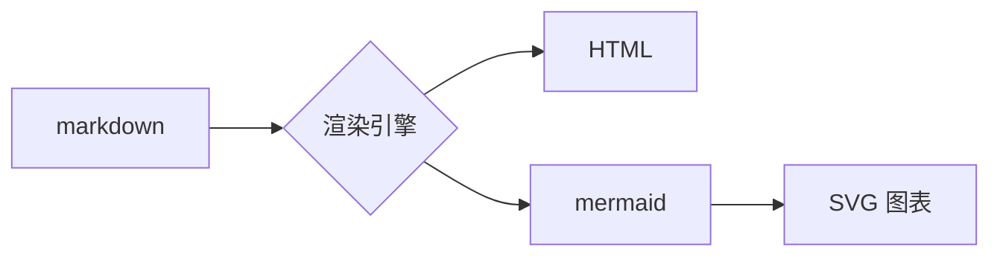

# 图片与排序测试

这一页验证三件事：带空格的文件名（角括号写法）、目录排序、TOC。

## 带空格的图片

正文嵌入（角括号语法，真实截图文件名带空格）：


## 链接形式

点这个[下载测试图 3](<测试图 3.png>)。

## 表格与引用

| 特性 | 状态 |
| --- | --- |
| 空格文件名嵌入 | 已修复 |
| %20 双编码 | 已修复 |
| BOM front-matter | 已修复 |

> 引用块样式：简约、精致、2026。

`行内代码` 与代码块：

```php
echo 'hello DirDocs';
```

## 图表（mermaid）


